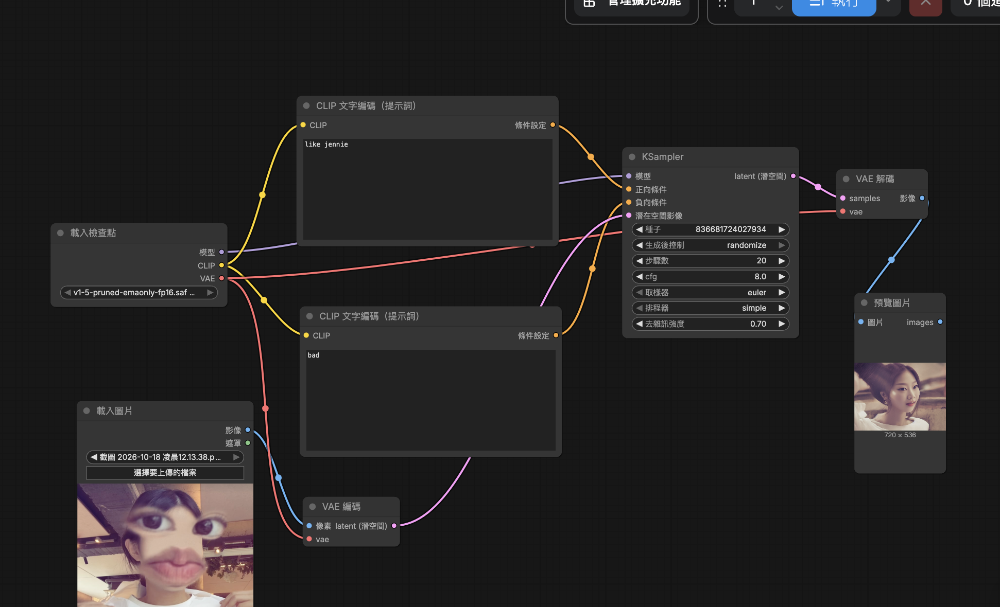

<!DOCTYPE html>
<html lang="en">
<head>
    <meta charset="UTF-8">
    <meta name="viewport" content="width=device-width, initial-scale=1.0">
    
</head>
<body>
    <h2>原圖</h2>
    
    <h2>新圖</h2>
    
    <h2>完整工作流程截圖</h2>
    
    <h3>正提示詞</h3>
    
like jennie

    <h3>負提示詞</h3>
    
 bad
 
    <h2>心得</h2>
    
很特別的體驗，生成出來的照片和想像中落差頗大，讓我有點意外。

</body>
</html>